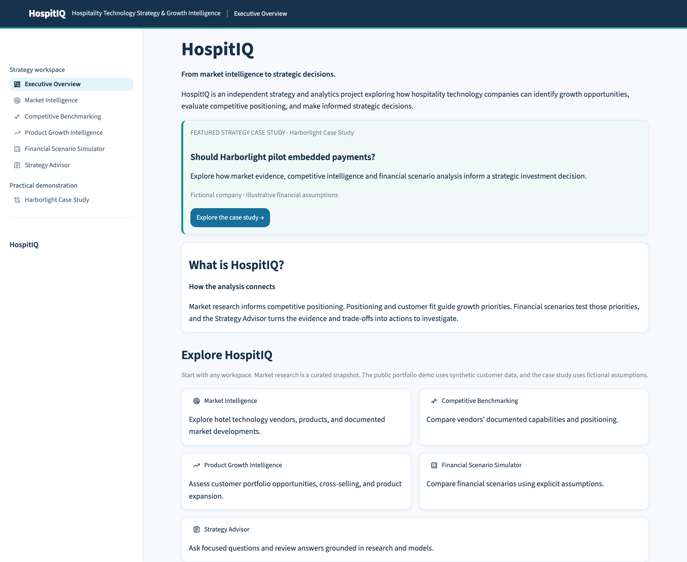
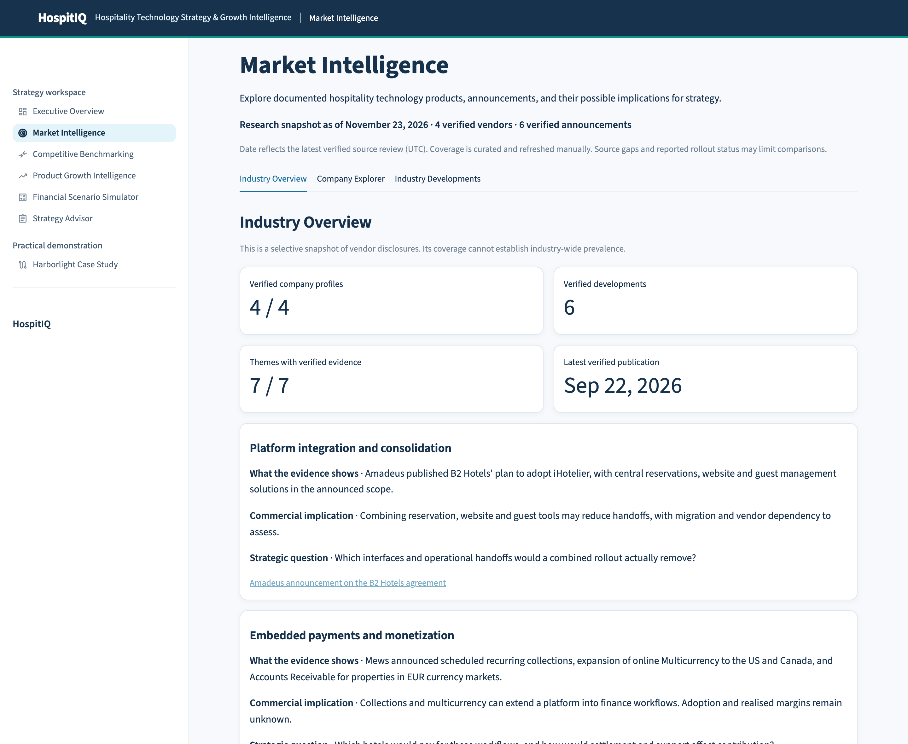
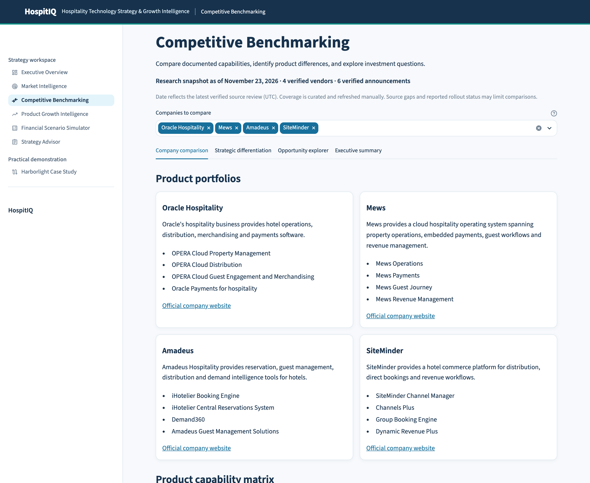
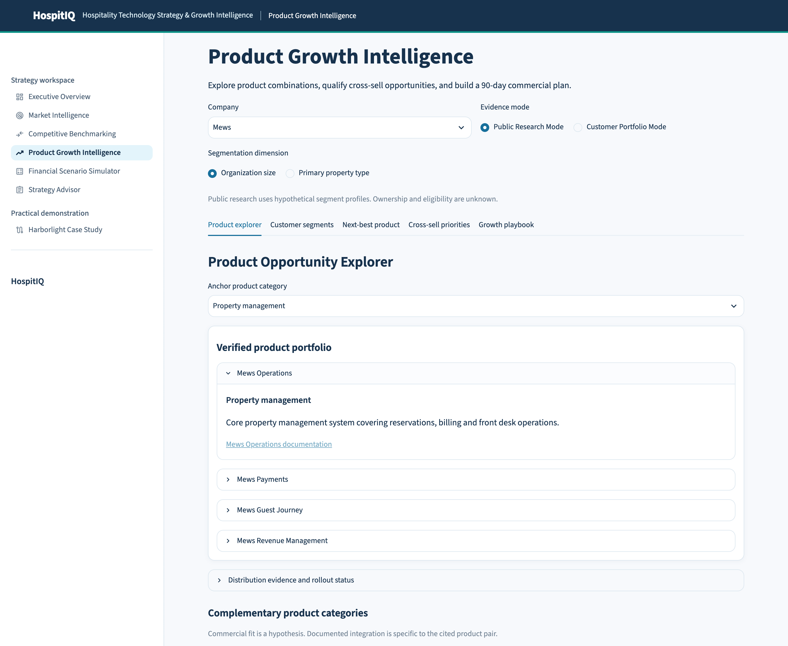
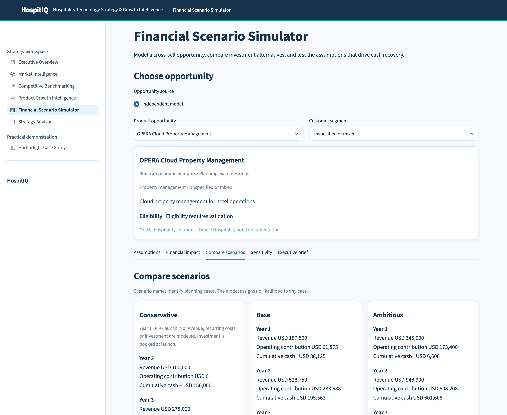
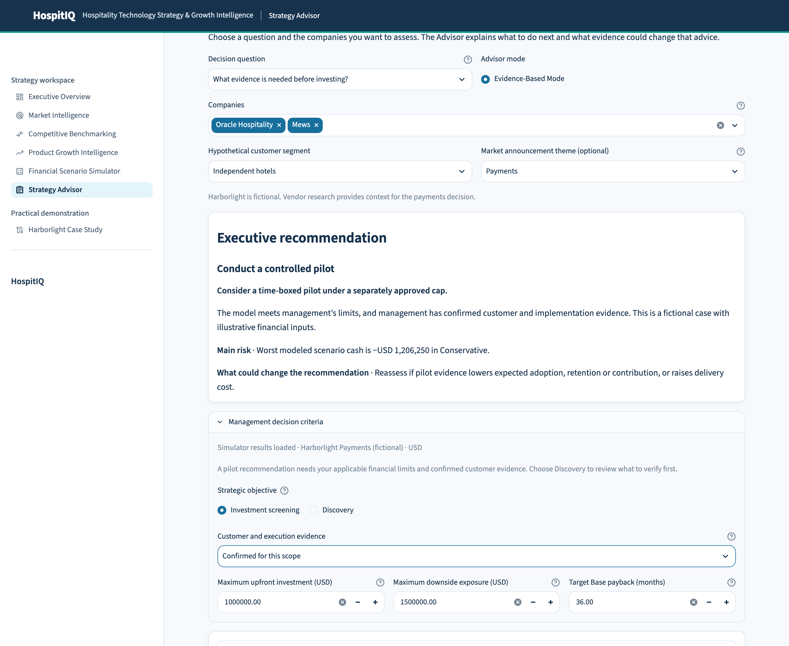
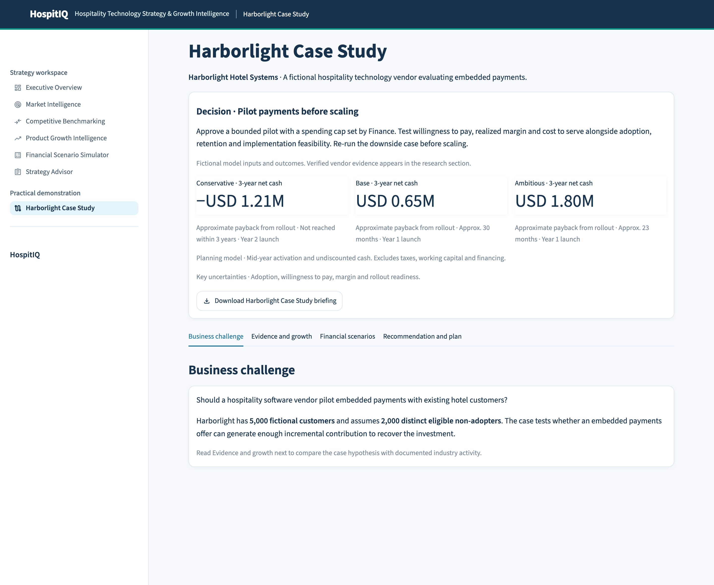

# HospitIQ

**Hospitality Technology Strategy & Growth Intelligence**

*From market intelligence to strategic decisions.*

HospitIQ is an independent strategy and analytics project for investigating where hospitality technology companies can grow, how vendors position their products, and what evidence would justify an investment. It connects a curated research snapshot, competitive evidence, cross-sell discovery, financial scenarios, and a source-linked decision agenda.

## Explore the application



| Workspace | What you can do |
| --- | --- |
| Executive Overview | Understand the workflow and open the fictional Harborlight walkthrough. |
| Market Intelligence | Explore selected strategic themes, vendor documentation, and SiteMinder’s FY24–FY26 financial disclosures. |
| Competitive Benchmarking | Compare documented product capabilities, rollout status, and evidence gaps. |
| Product Growth Intelligence | Prioritize discovery opportunities using segment fit, workflow relevance, commercial value, and feasibility. |
| Financial Scenario Simulator | Compare three-year cash outcomes and test which assumptions drive them. |
| Strategy Advisor | Get conditional recommendations grounded in reviewed evidence, management criteria and transferred scenario results. |
| Harborlight Case Study | Follow a fictional embedded-payments decision from initial evidence to a proposed bounded pilot. |

<details>
<summary>Market Intelligence</summary>



</details>
<details>
<summary>Competitive Benchmarking</summary>



</details>
<details>
<summary>Product Growth Intelligence</summary>



</details>
<details>
<summary>Financial Scenario Simulator</summary>



</details>
<details>
<summary>Strategy Advisor</summary>



</details>

### How the Strategy Advisor reaches a decision

The Advisor handles six questions spanning growth discovery, market developments, competitive differentiation, cross-sell risk, strategic trade-offs and investment diligence. It can prioritize a discovery candidate, propose further investigation or identify where the available evidence is insufficient for a commitment. It compares strategic alternatives qualitatively and evaluates one modeled investment at a time.

To screen an investment, open **Executive brief** in the Financial Scenario Simulator and select **Open results in Strategy Advisor**. Set management’s upfront investment cap, downside tolerance and target Base payback, then confirm the status of customer and implementation evidence. The Advisor checks the matching Conservative, Base and Ambitious results against those limits. It can recommend a controlled pilot, redesign or deferral and explains the relevant gates, risks, next steps and conditions for revisiting the decision.

The public Advisor uses local rules and curated research in Evidence-Based Mode. Management supplies the limits and confirms qualification. Scenario inputs are illustrative, research coverage is bounded, and gaps in either can limit the recommendation. See the [decision policy](PHASE8_DECISION_POLICY.md) for the checks and their order.

<details>
<summary>Harborlight Case Study</summary>



</details>

The five HTML exports cover the executive comparison, commercial growth playbook, financial briefing, strategy briefing, and Harborlight case briefing.

## Run locally

Use Python **3.12**. From the repository root:

```bash
python3.12 -m venv .venv
source .venv/bin/activate
python -m pip install -r requirements.txt
python -m streamlit run streamlit_app.py --server.address=127.0.0.1
```

Open [http://localhost:8501](http://localhost:8501). Evidence-Based Mode assembles the strategy agenda locally. This public release disables external AI requests and customer CSV uploads server-side, including when private-mode environment flags are set. The portfolio workflow uses labeled synthetic data. No API credentials or Streamlit secrets are required.

## Evidence and methodology

The app uses a manually reviewed snapshot of four vendor profiles and six documented announcements. A verified record means a first-party source supports the recorded statement. Vendor announcements and documentation describe capabilities and plans. Product availability, comparative performance, and commercial outcomes may require direct validation. The snapshot is selective and has no live refresh. Growth attractiveness scores are heuristics for discovery. Evidence confidence, ownership, and eligibility are evaluated separately.

The [research catalog](research/market_catalog.json) contains source links, review metadata, and limitations. Examples include:

- [SiteMinder FY25 Annual Report](https://www.siteminder.com/wp-content/uploads/2025/08/250827_FY25-Annual-Report.pdf), [FY26 Annual Report](https://www.siteminder.com/wp-content/uploads/2026/08/Annual-Report-SiteMinder-FY26.pdf), and [FY26 Investor Presentation](https://www.siteminder.com/wp-content/uploads/2026/08/Presentation-SiteMinder-FY26.pdf) for reported AUD revenue, transaction mix, and product reach.
- [Oracle Hospitality hotel documentation](https://docs.oracle.com/en/industries/hospitality/hotels.html) for documented property-management workflows.
- [Mews Payments documentation](https://help.mews.com/s/article/Mews-Payments) and [Mews Marketplace documentation](https://help.mews.com/s/article/Mews-Marketplace) for embedded payments and documented distribution rollout status.

SiteMinder’s aggregate results describe the company’s reported revenue mix. They do not establish product-level margins, cross-sell causality, or eligible customer counts.

## Harborlight Case Study

Harborlight is fictional. The case starts with **2,000 assumed eligible non-adopters** and mid-year activation, which counts half a year of revenue for new adopters. Retained adopters contribute a full year. Annual adoption applies to the remaining eligible pool. Calculations retain fractional expected cohorts even where display counts are rounded.

| Assumption | Conservative | Base | Ambitious |
| --- | ---: | ---: | ---: |
| Launch year | 2 | 1 | 1 |
| Adoption in operating years | 14%, 15% | 20%, 22%, 24% | 26%, 28%, 30% |
| Annual revenue per adopter | USD 2,500 | USD 3,000 | USD 3,250 |
| Contribution margin | 50% | 60% | 65% |
| Annual retention | 85% | 90% | 94% |
| Annual fixed costs from rollout | USD 420,000 | USD 400,000 | USD 450,000 |
| One-time investment at rollout | USD 1,000,000 | USD 900,000 | USD 1,000,000 |
| **Three-year cumulative net cash** | **−USD 1,206,250.00** | **+USD 647,808.00** | **+USD 1,800,741.40** |
| Approximate payback from rollout | Beyond the modeled horizon | 30 months | 23 months |

The Conservative case assumes no pre-launch spending. The model estimates undiscounted cash contribution and excludes tax, financing, working capital, depreciation, and cash beyond the three-year horizon. Equal relative shocks and business uncertainty ranges answer different questions. In Harborlight, revenue per adopter and contribution margin lead the equal-shock comparison. Adoption leads under the assumed uncertainty ranges. The case recommends a capped pilot to validate eligibility, pricing, adoption, retention, and delivery costs before scaling.

## Validate or host

```bash
python -m data_services.research_refresh validate
python -m unittest discover -s tests -q
```

For Streamlit Community Cloud, use repository `Joe05062000/HospitIQ`, branch `main`, main file `streamlit_app.py`, and Python **3.12**. Leave Secrets empty.

## Independence

HospitIQ is independently developed. The project is unaffiliated with and unendorsed by the companies it discusses. Harborlight and the customer portfolio are fictional. The case results are illustrative and do not represent any company’s forecasts or realised outcomes.
